<p align="center">
  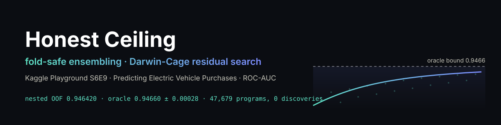
</p>

<p align="center">
  <a href="LICENSE"></a>
  
  <a href="https://github.com/Agnuxo1/s6e9-honest-ceiling/actions/workflows/ci.yml"></a>
  <a href="https://www.kaggle.com/competitions/playground-series-s6e9"></a>
  <a href="https://agnuxo1.github.io/s6e9-honest-ceiling/"></a>
</p>

**How high can an honest model go on a synthetic tabular competition, and how do you know when you have arrived?**
This repository answers both questions for [Kaggle Playground Series S6E9](https://www.kaggle.com/competitions/playground-series-s6e9)
(predict `Will_Buy_EV`, ROC-AUC, 668,665 training rows). It contains a fully fold-safe ensembling pipeline, an
evolutionary search that starts from noise and is rewarded only by structure it finds in the residual, a power
analysis of that search, and every number behind the claims.

**Contents** — [Results at a glance](#results-at-a-glance) · [Background](#background) · [Why every top score looks the same](#why-every-top-score-looks-the-same) · [The private leaderboard confirmed the ceiling](#the-private-leaderboard-confirmed-the-ceiling) · [What is inside](#what-is-inside) · [Quickstart](#quickstart) · [Method in one screen](#method-in-one-screen) · [The Darwin-Cage experiment](#the-darwin-cage-experiment) · [What did not help (measured, not assumed)](#what-did-not-help-measured-not-assumed) · [Open doors](#open-doors) · [Possible improvements](#possible-improvements) · [Real-world applications](#real-world-applications) · [Provenance and licences](#provenance-and-licences) · [Citation](#citation) · [Acknowledgements](#acknowledgements) · [Bibliography](#bibliography)

<!-- impact-note:start -->
<sub><strong>Efficiency and practical value.</strong> Honest Ceiling combines fold-safe ensembling with residual analysis and a reserved-fold search for remaining predictive structure. Its practical value is to distinguish useful model improvements from noise before committing further training effort. The <a href="#the-darwin-cage-experiment">power-checked search</a> records both failed candidates and detectable planted signals, giving teams a reusable basis for allocating experiments and setting defensible stopping criteria.</sub>
<!-- impact-note:end -->

## Results at a glance

| | Value | Evidence |
|---|---|---|
| Best honest blend, **nested** out-of-fold ROC-AUC | **0.946420** | [`results/blend_v4_report.json`](results/blend_v4_report.json) |
| Oracle bound (AUC if our probabilities were exactly right) | 0.94660 ± 0.00028 | [`results/residual_and_ceiling.json`](results/residual_and_ceiling.json) |
| Folds won against the public six-view ensemble | 10 / 10 | same file, `per_fold_v4_minus_six` |
| Paired gain at private-split size (229k rows, 60 subsamples) | +0.000073 ± 0.000016, P(better) = 1.00 | same file |
| Darwin-Cage programs evaluated / confirmed on the reserved fold | 47,679 / **0** | [`results/darwin_run*_hall.json`](results) |
| Public leaderboard, honest blend v4 | 0.94638 | [`results/submissions.json`](results/submissions.json) |
| **Private leaderboard, final selection** | **0.94560**, rank **173 / 3,576** (top 5 %) | [`results/private_leaderboard.json`](results/private_leaderboard.json) |

The honest blend sits within the sampling error of its own oracle bound. The residual behaves like independent
coin flips, and an unconstrained search over 47,679 feature programs found nothing that survives a fold it never
saw. The power analysis shows the search finds planted structures worth about 0.002-0.005 AUC, and where its limits are.

<picture>
  <source media="(prefers-color-scheme: dark)" srcset="figures/ceiling_dark.png">
  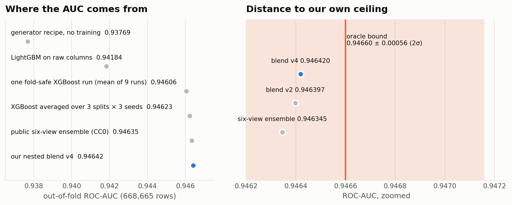
</picture>

## Background

<p align="center"><picture><source media="(prefers-color-scheme: dark)" srcset="docs/readme/01-background-dark.gif">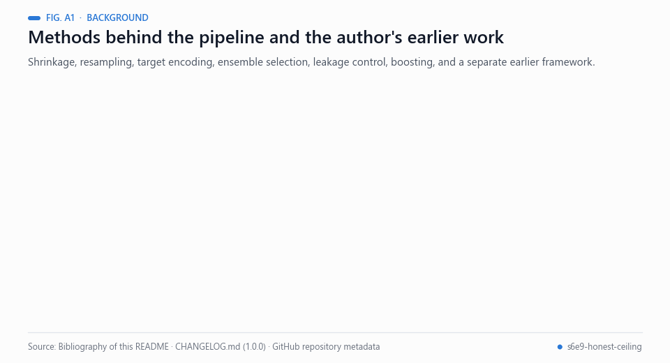</picture><br><sub>Animated figure A1 — Methods behind the pipeline, and the author's earlier work. Sources: bibliography below.</sub></p>

Kaggle Playground Series tasks are synthetic tabular problems scored on a public and a private part of the test rows.
How far repeated reuse of a held-out set overfits it has been analysed over more than one hundred Kaggle competitions [[1](#ref-1)]. In this
competition the gap was visible: the first-placed public score (0.94945) was 0.94588 on the private split, while the
private top 200 lay inside a range of 0.00046.

The pipeline is built from established parts: gradient-boosted trees [[2](#ref-2), [3](#ref-3)]; smoothed target encoding of
high-cardinality categorical columns [[4](#ref-4)] and empirical-Bayes shrinkage of group means [[5](#ref-5)]; a hill-climbing
selection of ensemble members over a library of models [[6](#ref-6)]; and a paired bootstrap for the size of a gain
[[7](#ref-7)]. What the repository adds is discipline about where each step may look. Target information that leaks into
features is a classic way to overstate performance [[8](#ref-8)], and selecting a model on the same folds that report its
score biases the estimate [[9](#ref-9)]; hence the single frozen split, the nested encoding and the nested blend. The
Darwin-Cage search applies the same logic to feature discovery: a program counts as a discovery only if it clears a
3σ threshold on a fold the search never saw, in the spirit of correcting for the number of candidates tested [[10](#ref-10)].

The author has also published a separate public reservoir-computing framework [[11](#ref-11)]. The same nested-ensemble and
residual-diagnostic workflow was later applied to another tabular task in a separate public repository [[12](#ref-12)].

## Why every top score looks the same

The public top 200 is packed into 0.0003 of AUC. One positive row of the 57k-row public split is worth about
0.00002, so ranks 2 to 28 differ by roughly eight rows. The label is the generator's purchase recipe plus an
independent random draw per row; the only extra signal is that the generator copied incomes from a 10,000-row
original table, so an exact income value partially identifies an original row. Once a model target-encodes that
identity, nothing learnable remains. The first-placed public score (0.94945) comes with no published method. The
public discussion ([*Is there a leak?*](https://www.kaggle.com/competitions/playground-series-s6e9/discussion)) and
[megayak's notebook](https://www.kaggle.com/code/megayak/s6e9-0-94656-reading-the-public-split) showing that paired
submissions can read the public split suggest public-split information; such gains do not transfer to the private 80 %.

<picture>
  <source media="(prefers-color-scheme: dark)" srcset="figures/leaderboard_dark.png">
  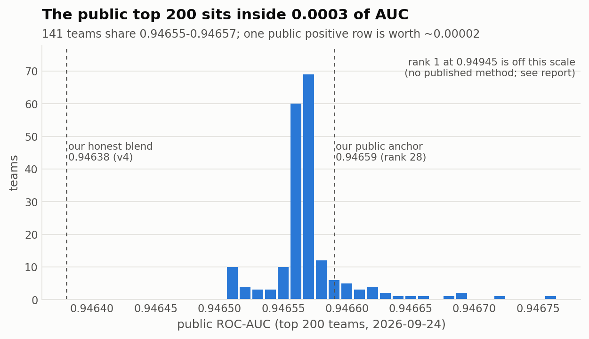
</picture>

## The private leaderboard confirmed the ceiling

<p align="center"><picture><source media="(prefers-color-scheme: dark)" srcset="docs/readme/02-private-leaderboard-dark.gif">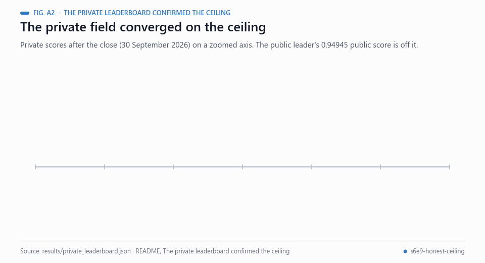</picture><br><sub>Animated figure A2 — Private scores after the close. Data: results/private_leaderboard.json.</sub></p>

The competition closed on 30 September 2026. The private split (the other 80 % of the test rows) behaved as this
analysis predicted:

* **The whole field converged on the ceiling.** The private top 200 lies between 0.94556 and 0.94602, a range of
  0.00046, which is about the width of the oracle interval above (± 0.00028).
* **Public-split gains did not transfer.** The public leader (0.94945) scored 0.94588 on the private split. The other
  teams in the public top 28 spread out between private ranks 1 and 214.
* **Both selected files reached our best private score, 0.94560.** No other of our 40 submissions scored higher.
  It is 0.00042 below first place and finished 173rd of 3,576 teams. The honest blend v4 scored 0.94545 privately.

The two selected files are later blends than v4: v8 is a 50/50 rank blend of blend v6 (v4 with the LightGBM family
extended to 15 runs) and a public Apache-2.0 generator-aware ridge GLM by heuljax, and v12 is a fixed logit-rank
version of the same mix. Both were frozen before their confirmation checks and were scored only on out-of-fold data.
The public GLM is third-party code and is not redistributed here.
Every per-submission score is in [`results/submissions.json`](results/submissions.json).

## What is inside

<p align="center"><picture><source media="(prefers-color-scheme: dark)" srcset="docs/readme/03-inside-dark.gif">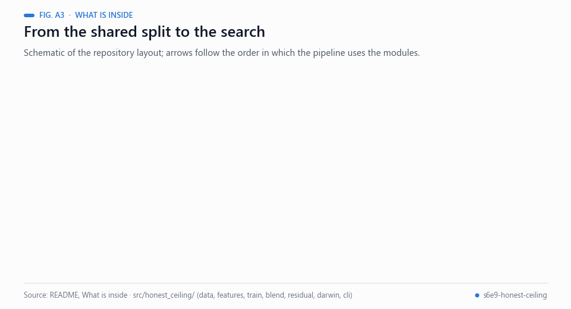</picture><br><sub>Animated figure A3 — Schematic of the repository layout, following the file tree below.</sub></p>

```
src/honest_ceiling/   installable package (pip install -e .)
  data.py             loading, the shared StratifiedKFold(10, seed 42) outer split
  features.py         generator recipe, digits, original-table lookups, nested target encoding
  train.py            fold-safe LightGBM / XGBoost legs, one checkpoint per fold
  blend.py            rank-space hill-climb with leave-one-fold-out evaluation, paired bootstrap
  residual.py         calibrated residual, whiteness tests, oracle bound
  darwin.py           Darwin-Cage search with a reserved confirmation fold, signal planting
  cli.py              honest-ceiling train | blend | residual | darwin
notebooks/            the two Kaggle notebooks (pipeline, Darwin Cage)
results/              every number quoted here, as JSON
figures/              light and dark versions of every figure
scripts/              figure rendering, power analysis
docs/                 method, results, reproduction guide, GitHub Pages report
tests/                synthetic-data tests (leakage, AUC, blending, search power), run in CI
```

## Quickstart

```bash
git clone https://github.com/Agnuxo1/s6e9-honest-ceiling && cd s6e9-honest-ceiling
pip install -e ".[gbdt]"
kaggle competitions download -c playground-series-s6e9 -p data && unzip -o data/*.zip -d data

# one fold-safe leg over the shared split (XGBoost uses CUDA when available)
honest-ceiling train --data-dir data --model xgb --seeds 42 101 2026 --outer-seeds 42 7 13
honest-ceiling train --data-dir data --model lgbm --seeds 42 101 2026 --outer-seeds 42 7 13

# nested hill-climb over every leg (+ optional public CC0 six-view OOF library on the same folds)
honest-ceiling blend --data-dir data --library path/to/s6e9-six-feature-views-oof-library

# what is left: whiteness tests, oracle bound, and the Darwin-Cage search
honest-ceiling residual --data-dir data --scores work/blend_oof_nested.npy
honest-ceiling darwin   --data-dir data --scores work/blend_oof_nested.npy --minutes 60
```

<p align="center"><picture><source media="(prefers-color-scheme: dark)" srcset="docs/readme/04-quickstart-dark.gif">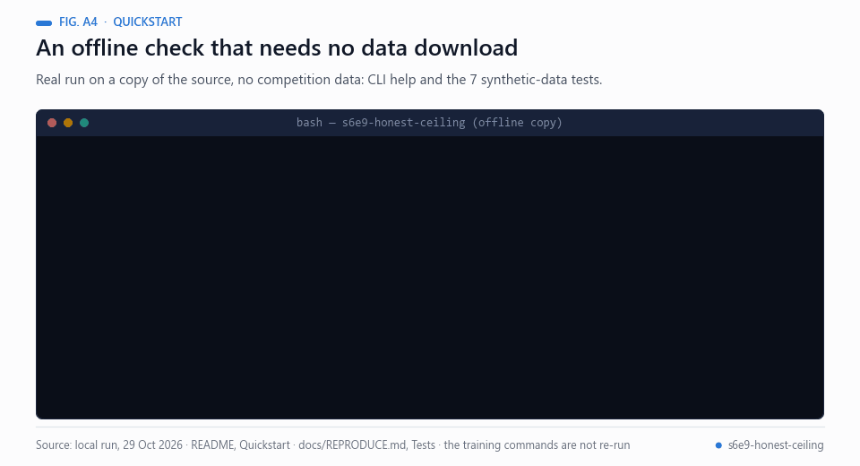</picture><br><sub>Animated figure A4 — A real offline run on a copy of the source: CLI help and the seven synthetic-data tests (about 14 s).</sub></p>

Full reproduction, timings and hardware: [docs/REPRODUCE.md](docs/REPRODUCE.md).

## Method in one screen

<p align="center"><picture><source media="(prefers-color-scheme: dark)" srcset="docs/readme/05-method-dark.gif">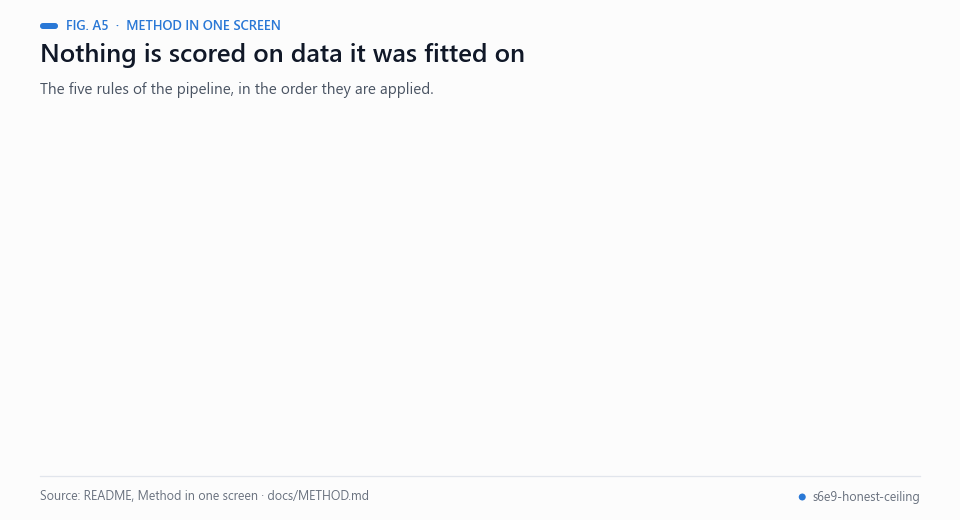</picture><br><sub>Animated figure A5 — The five rules in the list below, with the numbers they quote.</sub></p>

1. **One frozen split for everything.** `StratifiedKFold(10, shuffle=True, random_state=42)` over `train.csv` in id
   order, the split used by the public OOF libraries, so every out-of-fold file stacks row for row.
2. **Nested target encoding.** Exact income, nearest original income, income//100, //1000, exact commute and a few
   categorical interactions are encoded inside each outer-train partition with an inner 5-fold cross-fit. A training
   row never sees its own label; the outer fold is never seen at all.
3. **Early stopping without the scored fold.** A stratified 10 % slice of outer-train decides the number of trees.
4. **Averaging over splits.** Each GBDT family is trained on three outer splits (seeds 42, 7, 13) × three seeds and
   averaged in rank space: 0.94606 per run → 0.94623 per family, and +0.000023 for the final blend over one split.
5. **Nested blending.** Hill-climb weights are fit on 9 folds and scored on the 10th, for every fold, so the blend's
   reported AUC is itself out of fold.

Details and every ablation: [docs/METHOD.md](docs/METHOD.md).

<picture>
  <source media="(prefers-color-scheme: dark)" srcset="figures/folds_dark.png">
  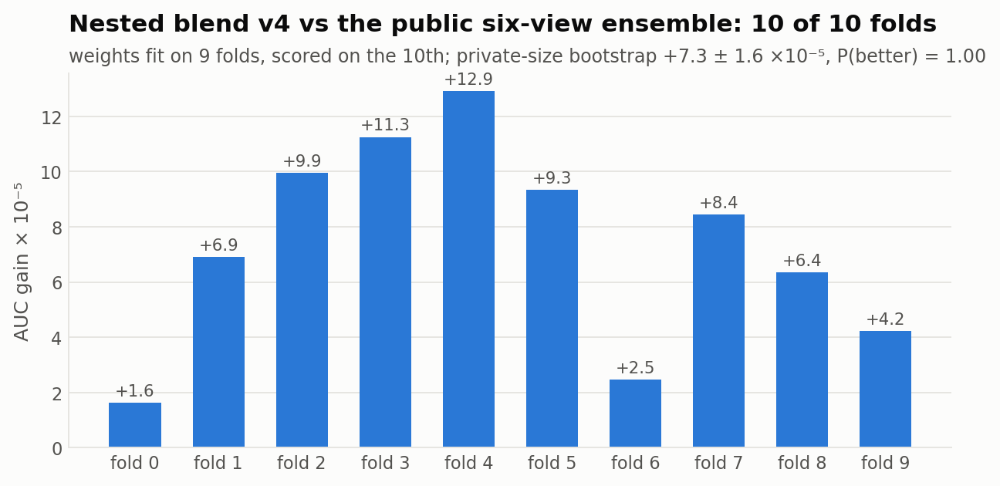
</picture>

## The Darwin-Cage experiment

The idea: do not tell the search what to look for or how. Start from random programs built out of the thirteen raw
columns (remainders, integer divisions, decimal digits, bit shifts, categorical values; up to four atoms), mutate and
recombine them, and reward each program only by how well its groups predict the **residual** of the best blend,
measured out of fold on nine search folds. The tenth fold is never touched by the search: a program is a discovery
only if its correlation there exceeds 3σ of the null (0.012 for 66,866 rows).

* Real residual: **47,679 programs, 27 hall-of-fame entries (6 distinct), 0 confirmed.** The best confirmation was
  0.0052 (z ≈ 1.3). Every entry that looked strong on the search folds collapsed on the reserved fold, which is the
  signature of multiple testing on white noise.
* Power analysis: labels are redrawn from the real calibrated probabilities plus a planted per-group shift of known
  size, and the same search runs for 30 minutes. It finds planted single-atom structures worth about 0.002 AUC in
  34 s to 4 min and a two-atom structure worth 0.005 AUC in 2 min; it **missed** a two-atom structure worth 0.002 AUC
  that was detectable in principle. Structures worth ≤ 0.0008 AUC cannot be confirmed on a 67k-row fold by any
  method. Full table: [docs/METHOD.md §10](docs/METHOD.md#10-power-analysis), data: [`results/power_summary.json`](results/power_summary.json).

<picture>
  <source media="(prefers-color-scheme: dark)" srcset="figures/darwin_dark.png">
  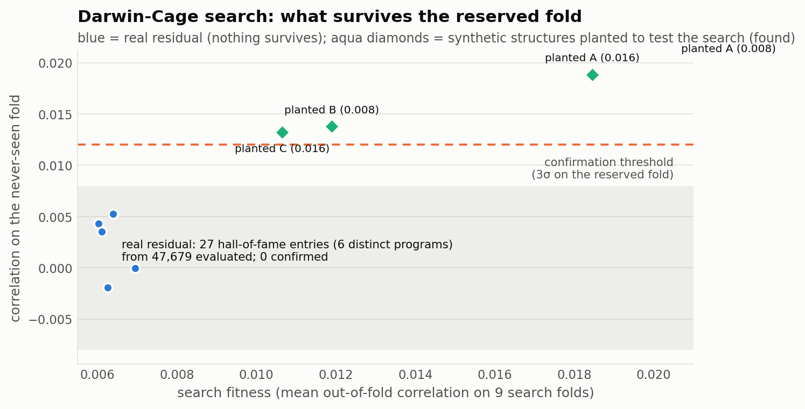
</picture>

<picture>
  <source media="(prefers-color-scheme: dark)" srcset="figures/power_dark.png">
  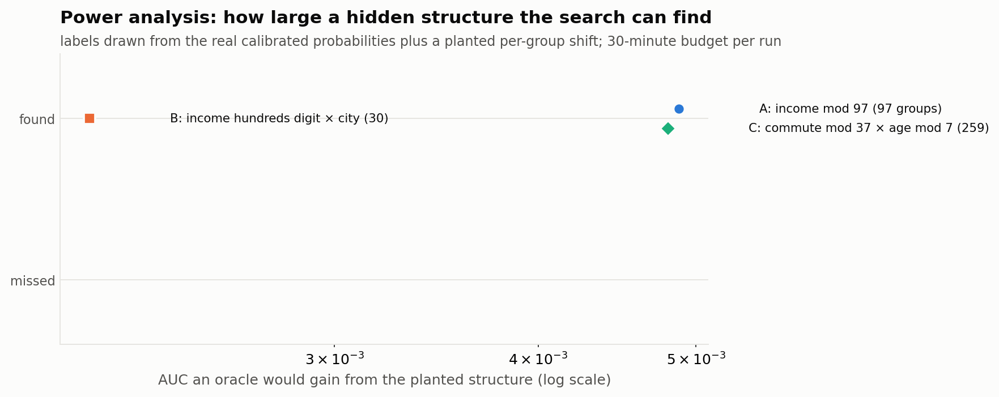
</picture>

## What did not help (measured, not assumed)

<p align="center"><picture><source media="(prefers-color-scheme: dark)" srcset="docs/readme/06-not-helped-dark.gif">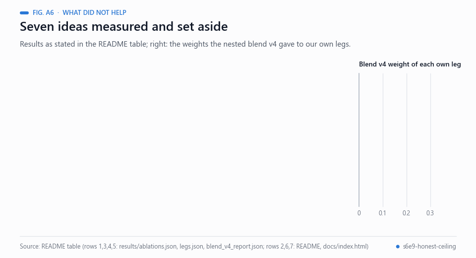</picture><br><sub>Animated figure A6 — The README table as a ledger, next to the nested blend v4 weights (results/blend_v4_report.json).</sub></p>

| Idea | Result |
|---|---|
| Exact income × recipe-cell target encoding | −0.00012 per fold; removed from the final legs |
| Original 10k rows as extra training data | public evidence 0/5 folds; used only as a lookup table here |
| Centred-window target rates, stronger smoothing, deeper trees | neutral or negative on 3 folds |
| Income × city / car type / home-charging encodings | −0.00001 to −0.00008 on 3 folds |
| Own MLP, RealMLP (pytabkit, 48 epochs), logistic regression, ladder view | zero blend weight |
| Reservoir-computing leg (random tanh + complex-phase expansion, ridge readout) | fold-0 AUC 0.936-0.940, +0.00001 in blend (noise) |
| CatBoost with string identity columns | fold-0 AUC 0.9431 at 12 min per fold; dropped |

Raw numbers: [`results/ablations.json`](results/ablations.json), [`results/legs.json`](results/legs.json).

<picture>
  <source media="(prefers-color-scheme: dark)" srcset="figures/residual_dark.png">
  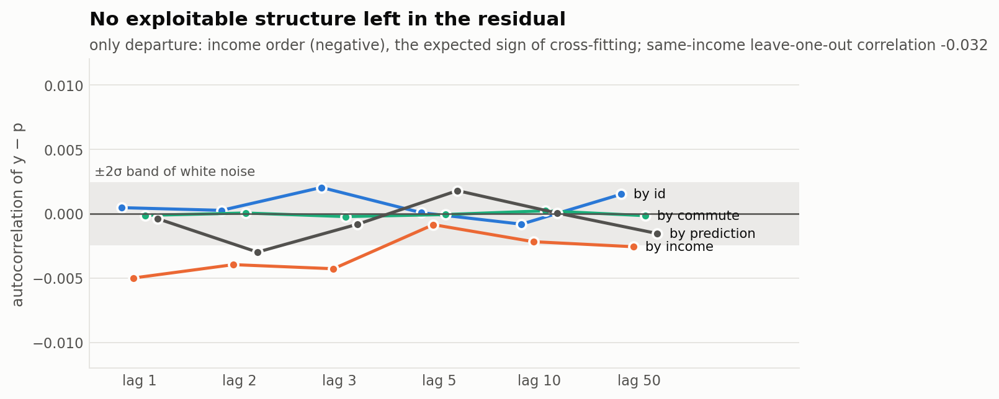
</picture>

## Open doors

<p align="center"><picture><source media="(prefers-color-scheme: dark)" srcset="docs/readme/07-open-doors-dark.gif">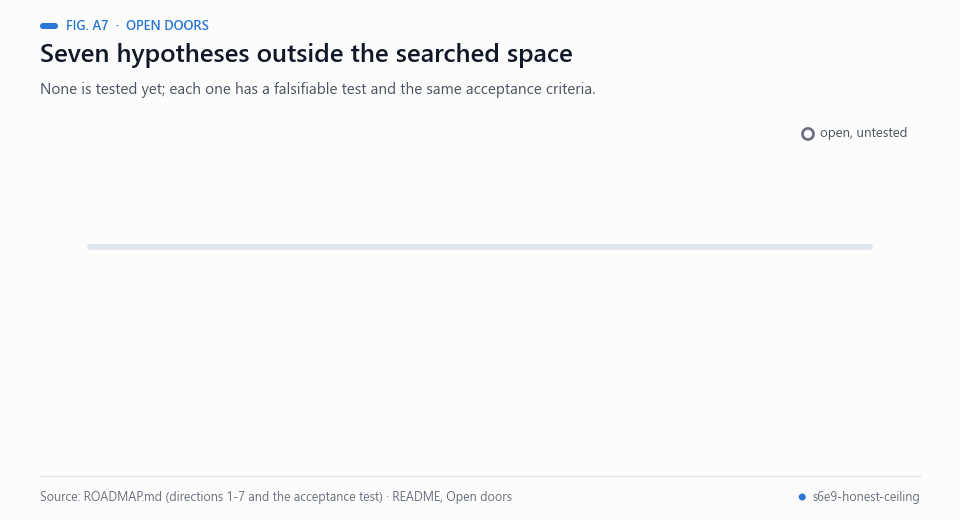</picture><br><sub>Animated figure A7 — The seven directions of ROADMAP.md, all untested, and the acceptance test they share.</sub></p>

A null result is only as good as the space it searched. The search alphabet here is integer transforms of single
columns and their joint keys, with group-mean readouts. Structures outside that space are untested, and several are
concrete enough to try: hierarchical (partial-pooling) encodings of the income identity, readouts that are not group
means, search over pairs of rows rather than single rows, neural program synthesis, and generator-level modelling of
how the synthetic rows were produced. Each is written up as a testable hypothesis with an acceptance criterion in
**[ROADMAP.md](ROADMAP.md)**. If you beat the numbers above honestly, please open an issue: we will add your result
and credit you.

## Possible improvements

<p align="center"><picture><source media="(prefers-color-scheme: dark)" srcset="docs/readme/08-improvements-dark.gif">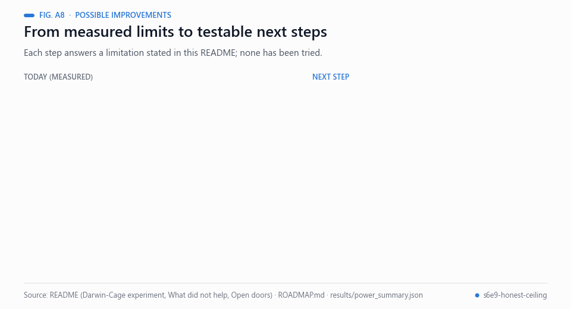</picture><br><sub>Animated figure A8 — Each improvement answers a limitation stated in this README. None has been tried.</sub></p>

Each item answers a limitation reported above. Items 1-4 are hypotheses with the acceptance test in
[ROADMAP.md](ROADMAP.md) (directions 7, 1, 6 and 2-3); none has been run. The last item is an analytic remark.

- **Search budget.** The power analysis found planted single-atom structures worth about 0.002 AUC but missed a
  two-atom structure of the same size. A sequential design that spends more evaluations near promising programs, tested
  by re-running that planted structure with the same budget, would show whether the miss was a budget problem.
- **Fixed smoothing priors.** Stronger fixed smoothing was neutral or negative on 3 folds. An empirical-Bayes,
  partial-pooling encoding of the income identity [[5](#ref-5)] would let the amount of shrinkage depend on the group; the
  same-income residual correlation (−0.032) is the first quantity to check.
- **Neural legs.** Our MLP and 48-epoch RealMLP received zero blend weight. Training a RealMLP to convergence is a direct
  test of whether a neural leg can earn weight (ROADMAP direction 6: public RealMLP 0.9461 against our 0.9454; budget about
  20 GPU-hours on an RTX 3090). RealMLP is described in [[13](#ref-13)].
- **Search alphabet.** The search reads group means of integer transforms of single columns. Readouts that are not group
  means, and programs over neighbourhoods of rows, widen the space that the null result covers.
- **Detection floor.** With a reserved fold of 66,866 rows the 3σ threshold is 0.012 on the correlation scale, and
  structures worth ≤ 0.0008 AUC cannot be confirmed there. By that formula the threshold falls only with the square root
  of the reserved sample size, so a larger reserved set helps slowly.

## Real-world applications

<p align="center"><picture><source media="(prefers-color-scheme: dark)" srcset="docs/readme/09-applications-dark.gif">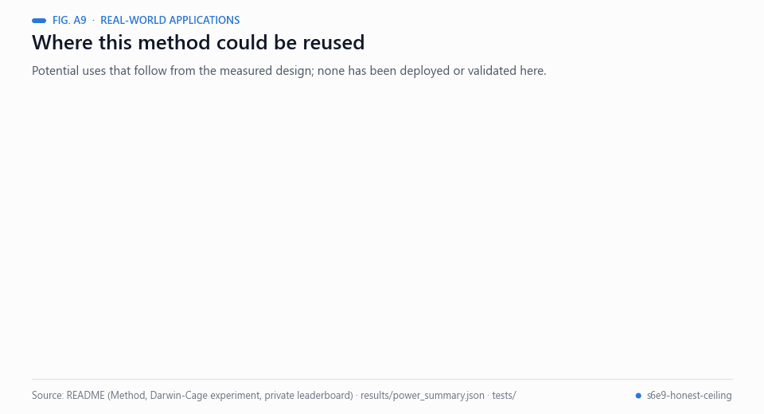</picture><br><sub>Animated figure A9 — Where the method could be reused. These are potential uses, not deployments.</sub></p>

The setting is a competition, so the following are potential uses of the method, not results of this repository:

- **Estimating a ceiling early.** An oracle bound tells a team whether the remaining gap is signal or sampling noise.
  Here the nested blend (0.946420) sits within the sampling error of its oracle bound (0.94660 ± 0.00028).
- **Honest model validation.** One frozen split, nested encoding and a nested blend give out-of-fold scores in which
  the encodings and the blend weights were never fitted on the scored fold; feature and hyper-parameter choices were still
  made on outer folds 0-2 (docs/METHOD.md, section 5), which is the residual optimism [[9](#ref-9)].
- **Leakage audits.** The nested target encoder, with a test that it never sees its own label, is a template for checking
  that target-derived features stay inside their training partition [[8](#ref-8), [14](#ref-14)].
- **Power-checked negative results.** Planting a signal of known size and re-running the search states what it could have
  found, so "nothing found" comes with a detection limit.
- **Auditing synthetic tables.** Tabular generators (for example copula [[15](#ref-15)] or diffusion models [[16](#ref-16)]) are
  one possible source of residual structure. In this competition the one extra signal found was the generator's copy of incomes from a 10,000-row
  original table; the residual tests and the reserved-fold search are one way to look for others.
- **Teaching and review.** The test suite runs offline on synthetic data with the competition schema and shows fold-safe
  practice without any download.

## Provenance and licences

* Competition data: [Kaggle S6E9](https://www.kaggle.com/competitions/playground-series-s6e9), CC BY 4.0. Not
  redistributed here; download it with the Kaggle CLI.
* Original table: [itzzomkar / EV Adoption Behavior and Range Anxiety](https://www.kaggle.com/datasets/itzzomkar/ev-adoption-behavior-and-range-anxiety), CC0-1.0.
* Public OOF library used in the blend: [megayak / S6E9 Six Feature Views OOF Library](https://www.kaggle.com/datasets/megayak/s6e9-six-feature-views-oof-library), CC0-1.0.
* The generator's purchase and range-anxiety recipes were reconstructed by Chris Deotte in his public EDA notebook.
* No leaderboard probing, hidden labels or private sharing were used. Full statement: [NOTICE](NOTICE).

## Citation

```bibtex
@software{angulo_2026_honest_ceiling,
  author  = {Angulo de Lafuente, Francisco},
  title   = {Honest Ceiling: fold-safe ensembling and a Darwin-Cage residual search on Kaggle Playground S6E9},
  year    = {2026},
  url     = {https://github.com/Agnuxo1/s6e9-honest-ceiling},
  license = {Apache-2.0}
}
```

## Acknowledgements

Chris Deotte (generator recipes), megayak (six-view OOF library and the public-split analysis), Marc Maldonado Lorca
(original-row memory), Naji, Georgy Mamarin, Yusuke Hayashi and the S6E9 discussion community, whose careful public
measurements made an honest ceiling measurable.

Apache-2.0 © 2026 Francisco Angulo de Lafuente.

## Bibliography

1. <a id="ref-1"></a>Roelofs, R., Fridovich-Keil, S., Miller, J., Shankar, V., Hardt, M., Recht, B., & Schmidt, L. (2019). A meta-analysis of overfitting in machine learning. *Advances in Neural Information Processing Systems 32 (NeurIPS 2019)*. https://proceedings.neurips.cc/paper/2019/hash/ee39e503b6bedf0c98c388b7e8589aca-Abstract.html
2. <a id="ref-2"></a>Chen, T., & Guestrin, C. (2016). XGBoost: A scalable tree boosting system. *Proceedings of the 22nd ACM SIGKDD International Conference on Knowledge Discovery and Data Mining*, 785–794. https://doi.org/10.1145/2939672.2939785
3. <a id="ref-3"></a>Ke, G., Meng, Q., Finley, T., Wang, T., Chen, W., Ma, W., Ye, Q., & Liu, T.-Y. (2017). LightGBM: A highly efficient gradient boosting decision tree. *Advances in Neural Information Processing Systems 30 (NIPS 2017)*. https://proceedings.neurips.cc/paper_files/paper/2017/hash/6449f44a102fde848669bdd9eb6b76fa-Abstract.html
4. <a id="ref-4"></a>Micci-Barreca, D. (2001). A preprocessing scheme for high-cardinality categorical attributes in classification and prediction problems. *ACM SIGKDD Explorations Newsletter*, 3(1), 27–32. https://doi.org/10.1145/507533.507538
5. <a id="ref-5"></a>Efron, B., & Morris, C. (1975). Data Analysis Using Stein's Estimator and its Generalizations. *Journal of the American Statistical Association*, 70(350), 311–319. https://doi.org/10.1080/01621459.1975.10479864
6. <a id="ref-6"></a>Caruana, R., Niculescu-Mizil, A., Crew, G., & Ksikes, A. (2004). Ensemble selection from libraries of models. *Proceedings of the Twenty-First International Conference on Machine Learning (ICML '04)*, 18. https://doi.org/10.1145/1015330.1015432
7. <a id="ref-7"></a>Efron, B. (1979). Bootstrap Methods: Another Look at the Jackknife. *The Annals of Statistics*, 7(1), 1–26. https://doi.org/10.1214/aos/1176344552
8. <a id="ref-8"></a>Kaufman, S., Rosset, S., Perlich, C., & Stitelman, O. (2012). Leakage in data mining. *ACM Transactions on Knowledge Discovery from Data*, 6(4), 1–21. https://doi.org/10.1145/2382577.2382579
9. <a id="ref-9"></a>Varma, S., & Simon, R. (2006). Bias in error estimation when using cross-validation for model selection. *BMC Bioinformatics*, 7, 91. https://doi.org/10.1186/1471-2105-7-91
10. <a id="ref-10"></a>Dunn, O. J. (1961). Multiple Comparisons among Means. *Journal of the American Statistical Association*, 56(293), 52–64. https://doi.org/10.1080/01621459.1961.10482090
11. <a id="ref-11"></a>Angulo de Lafuente, F. (2026). *Holographic-Reservoir: Holographic Reservoir Computing Framework (simulation and optional ASIC hardware)* [Software repository]. GitHub. https://github.com/Agnuxo1/Holographic-Reservoir
12. <a id="ref-12"></a>Angulo de Lafuente, F. (2026). *Airline satisfaction — nested ensembles and Darwin-Cage diagnostics* [Software repository]. GitHub. https://github.com/Agnuxo1/s6e10-airline-satisfaction
13. <a id="ref-13"></a>Holzmüller, D., Grinsztajn, L., & Steinwart, I. (2024). Better by Default: Strong Pre-Tuned MLPs and Boosted Trees on Tabular Data. *arXiv* 2407.04491. https://arxiv.org/abs/2407.04491
14. <a id="ref-14"></a>Kapoor, S., & Narayanan, A. (2023). Leakage and the reproducibility crisis in machine-learning-based science. *Patterns*, 4(9), 100804. https://doi.org/10.1016/j.patter.2023.100804
15. <a id="ref-15"></a>Patki, N., Wedge, R., & Veeramachaneni, K. (2016). The Synthetic Data Vault. *2016 IEEE International Conference on Data Science and Advanced Analytics (DSAA)*, 399–410. https://doi.org/10.1109/DSAA.2016.49
16. <a id="ref-16"></a>Kotelnikov, A., Baranchuk, D., Rubachev, I., & Babenko, A. (2022). TabDDPM: Modelling Tabular Data with Diffusion Models. *arXiv* 2209.15421. https://arxiv.org/abs/2209.15421

---

<div align="center">
<sub>Built by <a href="https://github.com/Agnuxo1">Francisco Angulo de Lafuente</a> · every animated figure renders a
published file named in its footer or a real offline run of the test suite</sub>
</div>
